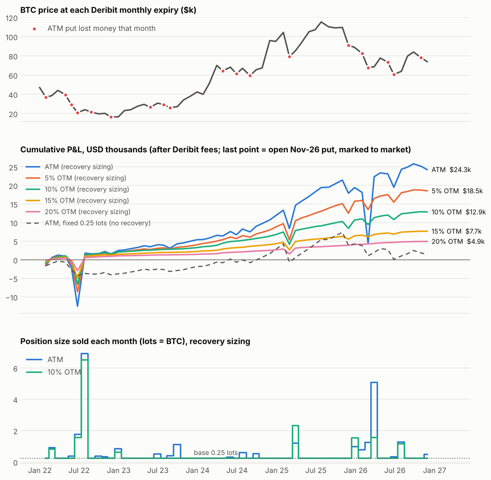
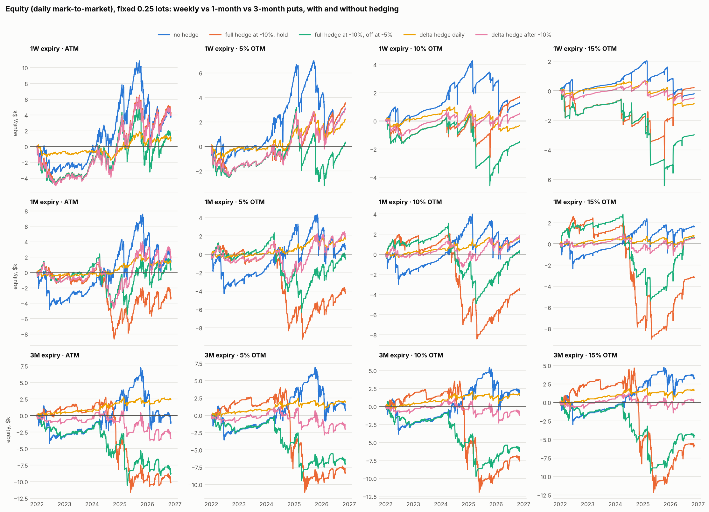
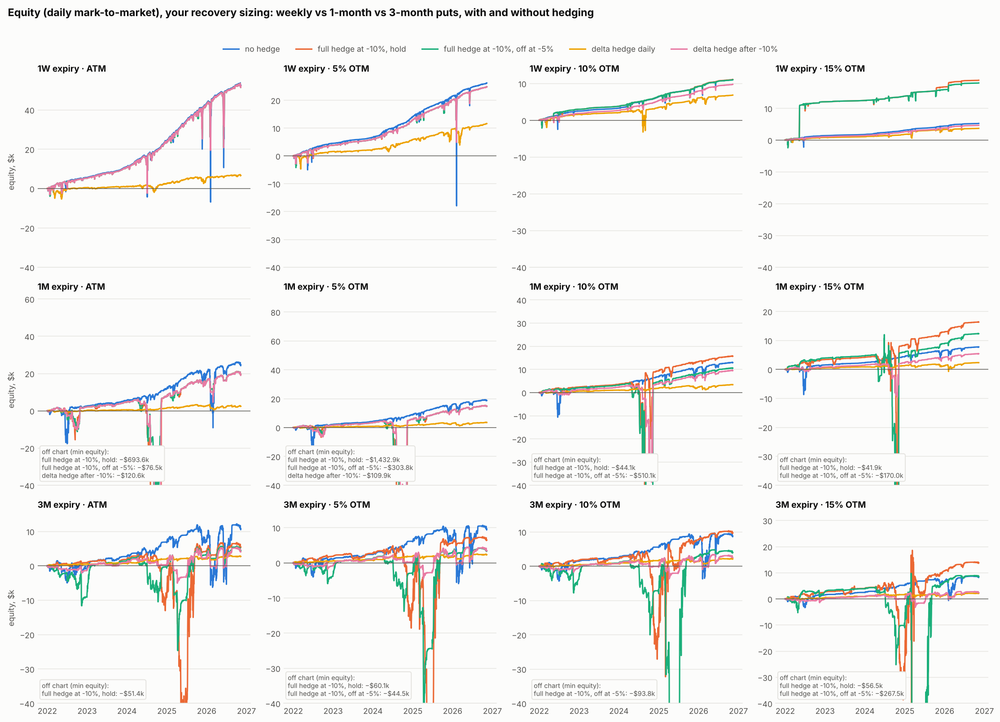
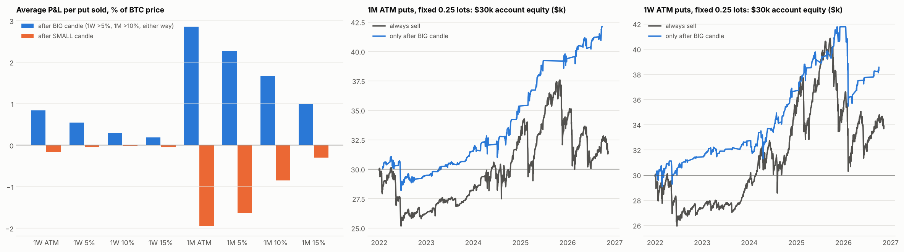

# Selling monthly BTC puts with loss-recovery sizing: backtest from 2022

**Strategy tested**

* Every month, at Deribit's monthly expiry (last Friday, 08:00 UTC), sell a BTC put that expires at the next monthly expiry, about 1 month away.
* Start at **0.25 lots**. On Deribit, 1 lot = 1 BTC.
* If the put expires in the money and the month ends with a net loss, **size up next month** so that the premium collected covers the loss. Once the loss is recovered, go back to 0.25 lots.
* Losses that are not yet recovered add up. If a recovery month also loses, its loss is added to the amount still to be recovered (the deficit).
* Period: 58 settled monthly cycles, from the put sold on 31 Dec 2021 (expiring 28 Jan 2022) to the put that expired 30 Oct 2026. The November 2026 put is still open and is shown marked to market as of 10 Nov 2026.

The rule doesn't say which strike to sell, so every variant was run at **ATM, 5%, 10%, 15% and 20% OTM**.

**Sizing variants compared**

| name | size each month |
|---|---|
| `base+cover` (**your rule**) | `0.25 + deficit / premium per lot` |
| `cover-only` | `max(0.25, deficit / premium per lot)` |
| `capped-2` | same as `base+cover`, but never more than 2 lots |
| `fixed` | always 0.25 lots (no recovery) |

## Data: real Deribit prices, not a model

* **Premium:** Deribit mark price of the actual listed put, from real trades in the first 2 hours after the previous expiry (`history.deribit.com`). The window widens to 6h or 24h only if there were no trades.
* **Spot at entry and settlement:** Deribit `btc_usd` delivery price, which is the index Deribit options settle against.
* **Strikes:** the listed strike nearest to `spot × (1 − OTM%)`.
* **Fees:** Deribit's 0.03% trade fee and 0.015% delivery fee, each capped at 12.5% of the option value.
* **Not included:** bid/ask slippage (mark ≈ mid) and Deribit's 0.1-lot size step (0.25 itself isn't a valid Deribit size). Everything is in USD.

## Results (settled months only, Jan 2022 – Oct 2026)

"Max collateral" means `size × strike` at the peak month: the cash needed to fully secure the put.

| Strike | Sizing | Total P&L | Losing months | Worst month | Max drawdown | Max size | Max collateral | P&L ÷ max collateral |
|---|---|---:|---:|---:|---:|---:|---:|---:|
| ATM | **base+cover** | **$25,141** | 19 / 58 | −$13,856 | −$17,147 | **6.91 lots** | **$344,760** | 7.3% |
| ATM | capped-2 | $19,183 | 19 / 58 | −$13,856 | −$17,147 | 2.00 | $138,000 | 13.9% |
| ATM | fixed 0.25 | $1,845 | 19 / 58 | −$4,930 | −$7,314 | 0.25 | $28,750 | 6.4% |
| 5% OTM | **base+cover** | **$18,758** | 15 / 58 | −$7,482 | −$9,548 | 6.35 | $128,250 | 14.6% |
| 5% OTM | capped-2 | $17,174 | 15 / 58 | −$7,482 | −$9,548 | 2.00 | $128,250 | 13.4% |
| 5% OTM | fixed 0.25 | $785 | 15 / 58 | −$4,364 | −$4,676 | 0.25 | $27,500 | 2.9% |
| 10% OTM | **base+cover** | **$12,924** | 8 / 58 | −$6,196 | −$7,666 | 6.52 | $163,100 | 7.9% |
| 10% OTM | capped-2 | $11,290 | 8 / 58 | −$6,196 | −$7,666 | 2.00 | $140,000 | 8.1% |
| 10% OTM | fixed 0.25 | $1,280 | 8 / 58 | −$3,302 | −$3,344 | 0.25 | $26,000 | 4.9% |
| 15% OTM | **base+cover** | **$7,683** | 8 / 58 | −$4,600 | −$5,677 | 6.64 | $167,700 | 4.6% |
| 15% OTM | fixed 0.25 | $1,625 | 8 / 58 | −$2,026 | −$2,026 | 0.25 | $24,500 | 6.6% |
| 20% OTM | **base+cover** | **$4,932** | 4 / 58 | −$2,740 | −$3,383 | 5.67 | $116,350 | 4.2% |
| 20% OTM | fixed 0.25 | $2,226 | 4 / 58 | −$1,336 | −$1,336 | 0.25 | $23,000 | 9.7% |

The full table, including `cover-only` and the remaining `capped-2` rows, is in [`results/summary.csv`](results/summary.csv). Every trade is in [`results/all_trades.csv`](results/all_trades.csv).

For reference, **holding 0.25 BTC** over the same period made about **+$7,800** (BTC went from $46,957 to $78,119).



### Stress test: one more bad month at the peak

The largest sizes all came in **July 2022**, after the May and June 2022 crash. The worst one-month BTC move in the sample was **−28%** (June 2022). This is what would have happened if the July 2022 recovery month had also dropped 28% ([`results/stress_test.csv`](results/stress_test.csv)):

| Strike | Size in Jul 2022 | Loss that month | New deficit | **Next month's size** | Next month's collateral |
|---|---:|---:|---:|---:|---:|
| ATM | 6.91 | −$26,824 | $40,585 | **19.9 lots** | $417k |
| 10% OTM | 6.52 | −$17,771 | $25,437 | **21.0 lots** | $400k |
| 20% OTM | 5.67 | −$7,515 | $10,898 | **17.7 lots** | $301k |

## Conclusions

1. **Your recovery rule worked in this sample.** Every loss was recovered within 2–4 months, and the deficit is back to about $0. It made **7–24× more** than a fixed 0.25-lot seller (ATM: $25.1k vs $1.8k).
2. **That extra profit comes from a martingale.** The rule increases exposure after losses. At the peak the position was **~27× the base size** (6.9 lots in Jul 2022), and the ATM version needed up to **$345k of collateral** (Mar 2026) to make $25k over 4.8 years. That is about 1.5% a year on peak capital.
3. **It survived only because losing streaks were short** (3 months at most). One more crash month at the peak would have meant selling about 20 lots, or $400k of collateral, the next month. A third loss would push past $1M. Recovery sizing doesn't remove the risk. It trades many small wins for a rare, very large loss.
4. **Without the recovery rule, selling BTC puts roughly broke even in 2022–2026.** It made +$0.8k to +$2.2k over 4.8 years, less than simply holding 0.25 BTC. The 2022 bear market, February 2025 and the Nov 2025 – Feb 2026 sell-off took back most of the premium.
5. **Capping the size gives a much better trade-off.** Capped at 2 lots, the ATM version kept **76% of the profit with 40% of the capital** ($19.2k on $138k vs $25.1k on $345k). Recovery then takes longer: up to 14 months in deficit instead of 4.
6. **5–10% OTM is the better zone.** Losing months fall from 19 (ATM) to 15 and 8, and the 5% OTM variants had the best return on collateral (13–15%).

### How to use these results

* If you run this strategy, **cap the size** (for example 2 lots, 8× the base). Let a large deficit be recovered over several months rather than all at once.
* Sell **about 5–10% OTM** rather than ATM.
* **Plan your capital for the peak, not the base.** With a 2-lot cap at BTC ≈ $70k, that is about $140k cash-secured. On Deribit, margin is posted in BTC, so it shrinks just when puts lose money.
* Decide a hard limit in advance: a deficit size or number of losing months after which you **reset to 0.25 lots and accept the loss**. Without one, a single long bear streak (like 2022 with one more leg down) can wipe out years of premium.

### Open position (Nov 2026 expiry, marked 10 Nov 2026, BTC ≈ $73.9k)

| Strike rule | Put sold | Size (your rule) | Unrealized P&L |
|---|---|---:|---:|
| ATM | 78000 P | 0.48 lots (carrying $663 from October) | −$886 |
| 5% OTM | 74000 P | 0.28 lots | −$217 |
| 10% OTM | 70000 P | 0.25 lots | −$62 |
| 15% / 20% OTM | 66000 P / 62000 P | 0.25 lots | about $0 |

---

## P&L and max drawdown at a glance (1-month puts, no hedge)

* **P&L:** settled months, Jan 2022 – Oct 2026.
* **"At expiries":** the drawdown counted only on expiry days.
* **"Daily MTM":** every open put is marked to market every day, so it also includes losses during the month.

| Strike | **Your rule** P&L | max DD at expiries | max DD daily MTM | **Fixed 0.25** P&L | max DD at expiries | max DD daily MTM |
|---|---:|---:|---:|---:|---:|---:|
| ATM | **+$25,141** | −$17,147 | **−$31,360** | +$1,845 | −$7,314 | −$7,606 |
| 5% OTM | **+$18,758** | −$9,548 | **−$13,814** | +$785 | −$4,676 | −$5,440 |
| 10% OTM | **+$12,924** | −$7,666 | **−$11,828** | +$1,280 | −$3,344 | −$4,488 |
| 15% OTM | **+$7,683** | −$5,677 | **−$9,516** | +$1,625 | −$2,026 | −$3,247 |

The deepest point for your rule at ATM came at the end of February 2026. A 5-lot recovery position for March had just been opened, and BTC kept falling.

---

## Part 2: 1-month vs 3-month expiry, with and without hedging (`hedged_backtest.py`)

**Variants**

* **Tenor**
  * **1M:** the same monthly cycle as above (58 settled months).
  * **3M:** sell a ~3-month put at each quarterly expiry (Mar/Jun/Sep/Dec), hold it to expiry, then sell the next one (19 settled quarters). The 0.25-lot base and the recovery rule are the same, applied once per quarter.
* **Hedges** use the BTC-PERPETUAL with real hourly prices and real funding (shorts receive funding when it is positive), at a 0.05% taker fee per trade.

| hedge | rule |
|---|---|
| no hedge | naked short put |
| full hedge at −10%, hold | stop order: when BTC trades 10% below the entry price, short **1 BTC per lot** and keep the short until expiry |
| full hedge at −10%, off at −5% | same, but buy the hedge back if BTC recovers to −5%. It can re-trigger any number of times |
| delta hedge daily | delta-neutral from day 1: re-hedge to the put's delta every day at 08:00 UTC |
| delta hedge after −10% | no hedge until BTC trades 10% below entry, then delta-hedge daily until expiry |

* **Stop hedges** are simulated on **1-minute BTC bars**. They fill at the trigger level (or worse if price gapped through it), with 0.1% slippage plus fees.
* **Daily mark-to-market.** Every open put is marked every day with Black-Scholes. The option's own entry implied vol (backed out of the real Deribit premium) is moved day by day with Deribit's DVOL index. Deltas come from the same model.
* **"P&L to date"** runs to 10 Nov 2026 and includes the open Nov-26 (1M) and Dec-26 (3M) puts, marked to market.

### Results: P&L to date / max drawdown (daily mark-to-market)

**Your recovery rule** (0.25 lots, sized up to cover losses):

| 1M | no hedge | full hedge at −10%, hold | full hedge at −10%, off at −5% | **delta hedge daily** | delta hedge after −10% |
|---|---:|---:|---:|---:|---:|
| ATM | +$24.1k / −$31.4k | +$19.0k / −$699.8k | +$19.0k / −$82.7k | **+$2.3k / −$2.9k** | +$18.9k / −$126.8k |
| 5% OTM | +$18.4k / −$13.8k | +$14.5k / −$1,437.6k | +$14.5k / −$308.5k | **+$3.4k / −$2.2k** | +$14.5k / −$114.6k |
| 10% OTM | +$12.8k / −$11.8k | +$15.6k / −$48.6k | +$10.4k / −$514.2k | **+$3.3k / −$1.8k** | +$9.4k / −$41.9k |
| 15% OTM | +$7.7k / −$9.5k | +$16.3k / −$51.2k | +$12.2k / −$182.0k | **+$2.3k / −$2.5k** | +$5.3k / −$11.6k |

| 3M | no hedge | full hedge at −10%, hold | full hedge at −10%, off at −5% | **delta hedge daily** | delta hedge after −10% |
|---|---:|---:|---:|---:|---:|
| ATM | +$10.5k / −$18.2k | +$5.5k / −$55.0k | +$4.4k / −$27.8k | **+$2.7k / −$1.4k** | +$4.0k / −$8.2k |
| 5% OTM | +$9.3k / −$16.3k | +$6.6k / −$64.9k | +$3.5k / −$46.7k | **+$2.3k / −$1.9k** | +$3.4k / −$7.7k |
| 10% OTM | +$8.6k / −$13.1k | +$9.8k / −$36.6k | +$4.1k / −$95.7k | **+$2.1k / −$2.2k** | +$2.5k / −$6.2k |
| 15% OTM | +$8.1k / −$8.5k | +$14.0k / −$73.2k | +$8.8k / −$277.2k | **+$2.0k / −$2.4k** | +$2.3k / −$5.6k |

**Fixed 0.25 lots** (shows the effect of each hedge without any size changes):

| 1M | no hedge | full hedge at −10%, hold | full hedge at −10%, off at −5% | **delta hedge daily** | delta hedge after −10% |
|---|---:|---:|---:|---:|---:|
| ATM | +$1.3k / −$7.6k | −$3.5k / −$10.2k | +$0.3k / −$7.9k | **+$1.3k / −$1.6k** | +$1.8k / −$6.5k |
| 5% OTM | +$0.5k / −$5.4k | −$4.3k / −$10.7k | −$0.5k / −$8.7k | **+$1.7k / −$1.3k** | +$1.8k / −$4.7k |
| 10% OTM | +$1.2k / −$4.5k | −$3.6k / −$10.7k | +$0.1k / −$8.0k | **+$1.5k / −$1.2k** | +$1.6k / −$2.9k |
| 15% OTM | +$1.6k / −$3.2k | −$3.2k / −$11.6k | +$0.6k / −$8.2k | **+$0.7k / −$1.3k** | +$0.5k / −$2.1k |

| 3M | no hedge | full hedge at −10%, hold | full hedge at −10%, off at −5% | **delta hedge daily** | delta hedge after −10% |
|---|---:|---:|---:|---:|---:|
| ATM | −$1.2k / −$9.5k | −$10.1k / −$14.4k | −$8.8k / −$10.8k | **+$2.4k / −$1.4k** | −$3.5k / −$4.7k |
| 5% OTM | +$0.7k / −$7.8k | −$8.2k / −$15.1k | −$6.9k / −$9.7k | **+$1.9k / −$1.6k** | −$2.0k / −$4.1k |
| 10% OTM | +$1.6k / −$6.0k | −$7.3k / −$15.5k | −$6.0k / −$10.5k | **+$1.6k / −$1.7k** | −$1.2k / −$3.4k |
| 15% OTM | +$3.2k / −$4.2k | −$5.7k / −$16.8k | −$4.3k / −$10.3k | **+$1.6k / −$1.7k** | +$0.0k / −$2.7k |

**Profit per $1 of max drawdown, fixed size.** This ratio doesn't depend on position size, so it is the fair way to compare the hedges:

| | no hedge | hedge at −10%, hold | hedge at −10%, off at −5% | **delta daily** | delta after −10% |
|---|---:|---:|---:|---:|---:|
| 1M ATM / 5% / 10% / 15% | 0.17 / 0.09 / 0.26 / 0.49 | < 0 | ≈ 0 | **0.85 / 1.30 / 1.25 / 0.55** | 0.28 / 0.38 / 0.55 / 0.25 |
| 3M ATM / 5% / 10% / 15% | −0.13 / 0.08 / 0.26 / 0.75 | < 0 | < 0 | **1.78 / 1.18 / 0.96 / 0.99** | < 0 or ≈ 0 |




Full results: [`results/hedged_summary.csv`](results/hedged_summary.csv), every cycle in [`results/hedged_trades.csv`](results/hedged_trades.csv), daily equity in [`results/hedged_equity_daily.csv`](results/hedged_equity_daily.csv).

### What Part 2 shows

1. **A stop that sells and buys back at the same −10% level destroys the strategy.** On 1-minute data it whipsawed **1,606 times** in 1M (−$49.9k on just 0.25 lots), and lost −$76.8k in 3M. It is kept in the CSV as `stop-10% naive` only as a warning.
2. **"Full hedge after −10%" loses money in both practical versions,** whether held to expiry or removed at −5%. In 2022–2026 BTC's −10% drops were usually followed by sharp rebounds. A 1-BTC short opened at −10% then lost on the rebound, and those losses were larger than the put losses it prevented. The worst case was the 3M put sold in Sep 2024: it was hedged at about $59k in Oct 2024, then BTC rallied to $95k by the December expiry (−$33k per lot on the hedge).
3. **Daily delta hedging is the only hedge that clearly works.**
   * Drawdown falls by **2.5–7×**, to about $1.2–1.7k at 0.25 lots.
   * P&L stays similar or improves (**3M ATM goes from −$1.2k to +$2.4k**). The exception is 15% OTM, where P&L roughly halves.
   * It turns the trade into collecting the gap between implied and realised volatility, instead of betting on direction.
   * It costs about $0.3–1.0k in perp fees over the 5 years at 0.25 lots. These fees are included in the results.
4. **Delta hedging only after −10% is a weak compromise.** It locks in the loss at the moment it starts. It helps a little in 1M and loses money in 3M.
5. **Your recovery rule must not be combined with hedges that realise losses.** The stop hedges and the "after −10%" delta hedge create extra losing months that the rule then tries to recover with bigger and bigger sizes. In 1M the size reached **12–517 lots**, with drawdowns of −$12k to −$1.4M. In 3M it reached up to 101 lots, with drawdowns down to −$277k. The naive stop went much further. **With daily delta hedging the rule stays tame:** at most 0.4–1.7 lots and drawdowns of −$1.4k to −$2.9k.
6. **3M vs 1M, unhedged:** 3M has fewer losing cycles (3–6 of 19 vs 8–19 of 58) but less total profit. It also needs your recovery rule to make money at ATM: fixed-size 3M ATM lost −$1.2k. **3M with a daily delta hedge** had the best profit per $ of drawdown in the whole test: 3M ATM made +$2.4k with a −$1.4k max drawdown.

### How to use these results

* **Don't use a fixed −10% stop as a hedge for short BTC puts.** Either it whipsaws (same-level buy-back) or it gets caught in rebounds (hold, or off at −5%).
* **If you hedge, delta-hedge daily from day 1 with the perp.** Because the drawdown is 2.5–7× smaller, you can sell a **larger** size for the same risk budget.
  * Example: 1 lot of **3M ATM, delta-hedged** (4× the base) would have made about **+$9.8k with about −$5.5k max drawdown**.
  * Unhedged 1M ATM at 0.25 lots made **+$1.3k with −$7.6k**.
  * Your unhedged recovery rule made +$24.1k but needed a −$31.4k drawdown and up to 6.9 lots.
* **If you keep your recovery rule,** use it only with daily delta hedging, or with no hedge plus a size cap (Part 1). Never use it with stop-type hedges.
* **Limits of the delta-hedged results:**
  * Deltas are model-based (Black-Scholes plus DVOL), and re-hedging is once a day.
  * A one-day crash still hits the position, and it also loses when implied vol spikes.
  * The edge is small in dollars (about $150–500 a year per 0.25 lot), so execution costs matter.

## Part 3: CAGR and max drawdown in % (`report_cagr.py`)

**All P&L figures above are totals** for the whole backtest, 31 Dec 2021 – 10 Nov 2026 (4.86 years). They are in USD, not per month.

To turn them into % returns, every variant is put on the **same $30,000 account**. That is enough to fully cash-secure 0.25 BTC puts even at the highest strike ($115k × 0.25 = $28.75k).

* Equity = $30k + cumulative daily mark-to-market P&L.
* Max DD % is measured from the running equity peak.
* Idle cash earns 0% here. In a real account T-bills would add roughly 4% a year in 2023–2026.

**CAGR / max drawdown on a $30k account**

| Tenor | Strike | **Your rule**, no hedge | Your rule, delta hedge daily | Fixed 0.25, no hedge | Fixed 0.25, delta hedge daily |
|---|---|---:|---:|---:|---:|
| 1M | ATM | **+13.1% / −61.4%** | +1.5% / −8.7% | +1.0% / −20.2% | +0.9% / −4.8% |
| 1M | 5% OTM | **+10.4% / −44.1%** | +2.2% / −6.5% | +0.4% / −15.8% | +1.1% / −4.0% |
| 1M | 10% OTM | **+7.6% / −38.0%** | +2.2% / −5.3% | +0.8% / −13.2% | +1.0% / −3.9% |
| 1M | 15% OTM | **+4.8% / −30.9%** | +1.5% / −7.9% | +1.1% / −10.0% | +0.5% / −4.4% |
| 3M | ATM | **+6.5% / −43.4%** | +1.8% / −4.2% | −0.7% / −25.4% | +1.6% / −4.2% |
| 3M | 5% OTM | **+5.8% / −40.4%** | +1.5% / −5.9% | +0.6% / −21.1% | +1.3% / −5.0% |
| 3M | 10% OTM | **+5.4% / −33.3%** | +1.4% / −6.7% | +1.1% / −16.9% | +1.1% / −5.3% |
| 3M | 15% OTM | **+5.1% / −22.5%** | +1.4% / −7.4% | +2.2% / −12.8% | +1.1% / −5.2% |
| | **Buy & hold BTC** with the $30k | **+9.9% / −66.8%** | | | |

**What the % view adds**

* **Your rule's higher CAGR needs leverage.** On the $30k account, the 1M ATM version reached a notional of **10.3× equity** (5–8× for the other unhedged strikes). That only works on margin. If you instead fund the peak notional in full (up to $345k), the same profit is a CAGR of only **1–3%**.
  * Its −61.4% max drawdown came in June 2022, when the account fell from about $31k to **$12.3k**.
  * The −$31.4k drawdown in dollars came later, in Feb 2026, from a higher equity peak.
* **With your rule, the stop hedges wiped out the $30k account** (equity went below zero) in 15 of 16 cases. The only survivor, 3M ATM with the hedge removed at −5%, still had an 84% drawdown. "Delta hedge after −10%" wiped it out at 1M ATM, 5% and 10% OTM. At fixed size, the stop hedges returned between +0.4% and −8.1% a year with drawdowns of 24–49%.
* **Delta-hedged variants** earn about **1–2% a year with only a 4–9% max drawdown**, the smoothest equity curves in the test. To reach higher returns you would scale the size up, and the drawdown scales with it.
* **Buy & hold BTC** did +9.9% a year but with a −66.8% drawdown (Nov 2022).

**Calendar-year returns** (% of equity at the start of the year; 2026 runs to 10 Nov):

| Variant | 2022 | 2023 | 2024 | 2025 | 2026 | CAGR | max DD |
|---|---:|---:|---:|---:|---:|---:|---:|
| 1M ATM, your rule, no hedge | +8.4% | +8.9% | +17.4% | +19.2% | +9.9% | +13.1% | −61.4% |
| 1M ATM, fixed, no hedge | −12.5% | +7.5% | +15.2% | +5.5% | −8.2% | +1.0% | −20.2% |
| 1M 10% OTM, your rule, no hedge | +7.0% | +3.7% | +10.2% | +10.9% | +5.3% | +7.6% | −38.0% |
| 1M 10% OTM, fixed, no hedge | −5.4% | +4.2% | +11.5% | −3.5% | −1.9% | +0.8% | −13.2% |
| 3M 15% OTM, fixed, no hedge | −5.3% | +3.4% | +9.0% | +4.3% | −0.3% | +2.2% | −12.8% |
| 1M 10% OTM, your rule, delta daily | +1.9% | +1.4% | +2.9% | +1.2% | +3.4% | +2.2% | −5.3% |
| 3M ATM, fixed, delta daily | +1.6% | +0.6% | +4.3% | −0.1% | +1.5% | +1.6% | −4.2% |
| Buy & hold BTC | −64.9% | +157.0% | +117.9% | −4.5% | −15.6% | +9.9% | −66.8% |

All variants: [`results/cagr_summary.csv`](results/cagr_summary.csv) and [`results/yearly_returns.csv`](results/yearly_returns.csv).

## Part 4: weekly puts (1W)

**Setup.** Every Friday at 08:00 UTC (Deribit weekly expiry), sell the put expiring the next Friday, then repeat.

* That is 253 settled weeks, plus the open 13-Nov-26 put.
* Same premiums source (real Deribit mark prices of the actual weekly puts), fees, strikes, recovery rule, hedges and $30k account as Parts 2–3.
* Weekly strikes were close to target: on average 0% / 5.0% / 9.9% / 14.9% OTM.
* The equity charts in Part 2 now have a 1W row.

**Total P&L / CAGR / max drawdown on the $30k account, 31 Dec 2021 – 10 Nov 2026**

Fixed 0.25 lots:

| Strike | 1W no hedge | **1W full hedge at −10%, hold** | 1W delta hedge daily | 1M no hedge | 3M no hedge |
|---|---:|---:|---:|---:|---:|
| ATM | $3,873 / +2.5% / −25.9% | **$4,303 / +2.8% / −18.0%** | $756 / +0.5% / −6.5% | $1,500 / +1.0% / −20.2% | −$997 / −0.7% / −25.4% |
| 5% OTM | $3,109 / +2.1% / −17.6% | **$3,540 / +2.3% / −10.1%** | $2,201 / +1.5% / −6.6% | $634 / +0.4% / −15.8% | $838 / +0.6% / −21.1% |
| 10% OTM | $1,298 / +0.9% / −11.2% | $1,728 / +1.2% / −10.0% | −$318 / −0.2% / −5.7% | $1,227 / +0.8% / −13.2% | $1,696 / +1.1% / −16.9% |
| 15% OTM | −$202 / −0.1% / −7.8% | $228 / +0.2% / −16.2% | −$878 / −0.6% / −5.6% | $1,625 / +1.1% / −10.0% | $3,294 / +2.2% / −12.8% |

Your recovery rule (0.25 lots + size up to cover losses), with the largest leverage reached (notional ÷ account equity):

| Strike | 1W no hedge | 1W full hedge at −10%, hold | 1W delta hedge daily | 1M no hedge |
|---|---:|---:|---:|---:|
| ATM | $52,420 / +23.1% / **−69.0%**, 49× | $52,122 / +23.0% / −40.7%, 24× | $6,576 / +4.2% / −18.6%, 7× | $24,478 / +13.1% / −61.4%, 10× |
| 5% OTM | $26,137 / +13.8% / **−76.8%**, 112× | $24,794 / +13.2% / −26.3%, 10× | $11,551 / +6.9% / −16.3%, 13× | $18,588 / +10.4% / −44.1%, 6× |
| 10% OTM | $10,983 / +6.6% / −12.2%, 9× | $11,040 / +6.7% / −7.6%, 8× | $6,795 / +4.3% / −18.5%, 61× | $12,872 / +7.6% / −38.0%, 5× |
| 15% OTM | $5,199 / +3.3% / −9.8%, 10× | $18,788 / +10.5% / −8.4%, 16× | $3,651 / +2.4% / −4.1%, 18× | $7,684 / +4.8% / −30.9%, 5× |

**Bid/ask cost: weekly options are the most sensitive.** Premiums in the backtest are Deribit mark prices (about mid). Selling **1 tick below mark** every time (0.0005 BTC, or 0.0001 BTC for options under 0.005 BTC) would have cost the following at fixed 0.25 lots ([`results/spread_sensitivity.csv`](results/spread_sensitivity.csv)):

| Tenor | 1 tick as % of a typical premium | P&L lost per 0.25 lot, ATM |
|---|---:|---:|
| 1W | 2–9% | about **−$1.9k**, roughly half the weekly ATM profit |
| 1M | 1–4% | about −$0.4k |
| 3M | 0.5–1.2% | about −$0.15k |

**Calendar-year returns, weekly** (% of equity at the start of each year):

| Variant | 2022 | 2023 | 2024 | 2025 | 2026 |
|---|---:|---:|---:|---:|---:|
| 1W ATM, fixed, no hedge | −8.9% | +8.0% | +18.2% | +1.2% | −4.0% |
| 1W ATM, fixed, hedge at −10% hold | −13.2% | +8.4% | +10.6% | +4.7% | +5.0% |
| 1W 5% OTM, fixed, hedge at −10% hold | −5.4% | +3.0% | +9.3% | −1.4% | +6.5% |
| 1W ATM, your rule, no hedge | +18.2% | +15.3% | +31.1% | +36.4% | +12.7% |
| 1W 5% OTM, your rule, delta daily | +5.2% | +2.3% | +11.1% | +10.4% | +5.0% |

### What weekly adds

1. **Weekly earns the most at ATM and 5% OTM, before spread costs.**
   * Fixed 0.25 lots made +$3.1–3.9k, against +$0.6–1.5k for 1M and −$1.0k to +$0.8k for 3M.
   * Losing weeks were 78/253 at ATM, 34 at 5% OTM, 11 at 10% OTM and 6 at 15% OTM.
   * **After a 1-tick bid/ask cost about half of that edge is gone.** Weekly only works with good execution, such as limit orders at or near mid.
   * At 15% OTM the premium is too small (about $94 per lot); it lost money even before spread costs.
2. **For weekly, "full hedge at −10%, hold to expiry" helps** (it lost money for 1M/3M). A rebound has at most a few days, so the hedge rarely gets caught in a big rally.
   * It cut the ATM drawdown from −25.9% to −18.0% and the 5% OTM drawdown from −17.6% to −10.1%, with slightly more profit.
   * With your rule it also cut the ATM drawdown from −69% to −41%.
3. **Daily delta hedging is weaker on weeklies than on 1M/3M.** One re-hedge a day is too slow for a 7-day option, whose delta moves fast near expiry.
4. **Your rule on weeklies is the most extreme martingale in the test.** Weekly premiums are small, so recovering one bad week needs a huge size.
   * In the week to 13 Feb 2026 it sold **17.4 lots ATM ($1.13M notional on a $30k account)** to recover a $50k deficit. It worked, but a second down week would have wiped out the account several times over.
   * The 5% OTM version reached 112× leverage.
   * The +23% CAGR therefore needs leverage no account should take. Fully funded, it is about 1% a year.

## Part 5: does the last candle predict the next put? (`candle_patterns.py`)

**Setup.** For every put sale (1W and 1M, no hedge), look at the **last BTC candle before entry**: the previous week for weekly puts, the previous monthly cycle for monthly puts. For weekly puts, the last daily candle is checked too.

* High/low come from 1-minute BTC-PERPETUAL bars.
* Features: return and colour, size, range, wicks (e.g. hammer-like candles).
* Outcome: P&L per lot as % of BTC price, so 2022 and 2025 are comparable.
* Overfitting checks: every bucket is shown for **both halves** of the sample (2022-01..2024-06 vs 2024-07..2026-11), and filter rules get a **permutation test** against 20,000 random selections of the same number of trades.

### What did not matter
* **Colour alone (green vs red)** gave no reliable edge (permutation p ≈ 0.3–0.5).
* **The last daily candle's colour** for weekly puts: p = 0.13–0.33.
* **Hammer-like candles:** nothing.

### The pattern that did: candle SIZE, in either direction

**Average P&L per put sold, as % of BTC price.** "Big" = the last candle moved more than **5% (week)** or **10% (month)**, up or down.

| | after BIG candle | after SMALL candle | big, 1st half / 2nd half | win rate big vs small | entry IV big vs small |
|---|---:|---:|---:|---:|---:|
| 1W ATM | **+0.84%** (93 trades) | −0.16% (161) | +0.91% / +0.75% | 75% vs 65% | 51% vs 43% |
| 1W 5% OTM | **+0.54%** | −0.05% | +0.69% / +0.34% | 90% vs 85% | 55% vs 47% |
| 1W 10% OTM | **+0.30%** | −0.01% | +0.49% / +0.05% | 98% vs 94% | 63% vs 55% |
| 1W 15% OTM | **+0.19%** | −0.05% | +0.31% / +0.02% | 99% vs 97% | 72% vs 65% |
| 1M ATM | **+2.85%** (29 trades) | **−1.95%** (30) | +1.96% / +4.31% | 79% vs 53% | 51% vs 45% |
| 1M 5% OTM | **+2.27%** | −1.63% | +1.90% / +2.87% | 90% vs 57% | 53% vs 46% |
| 1M 10% OTM | **+1.66%** | −0.85% | +1.69% / +1.62% | 97% vs 73% | 55% vs 49% |
| 1M 15% OTM | **+0.98%** | −0.30% | +1.02% / +0.93% | 97% vs 73% | 59% vs 52% |

**Why it plausibly works.** After a big move, in either direction, option sellers are paid more: entry implied vol is 6–9 points higher. BTC also tended to calm down after big moves. After a quiet candle, premiums are cheap and BTC often broke out of the range. That is the classic "sell volatility after it spikes, not when it is compressed".

### As a trading rule: sell only after a big candle, skip after a small one

$30k account, CAGR / max drawdown, with the number of trades taken:

| | always sell (fixed 0.25) | **only after BIG candle (fixed 0.25)** | permutation p | only after BIG candle + **your recovery rule** |
|---|---:|---:|---:|---:|
| 1M ATM | +1.0% / −20.2% (59) | **+7.4% / −9.2%** (29) | 0.007 | +8.7% / −13.4%, max 1.5 lots |
| 1M 5% OTM | +0.4% / −15.8% | **+5.8% / −7.7%** | 0.005 | +6.6% / −8.3%, max 1.2 lots |
| 1M 10% OTM | +0.8% / −13.2% | **+4.0% / −6.1%** | 0.009 | +4.6% / −6.1%, max 1.1 lots |
| 1M 15% OTM | +1.1% / −10.0% | +2.4% / −5.4% | 0.035 | +2.9% / −5.4%, max 1.2 lots |
| 1W ATM | +2.5% / −25.9% (254) | **+5.4% / −15.1%** (93) | 0.025 | account wiped out |
| 1W 5% OTM | +2.0% / −17.6% | +3.6% / −10.2% | 0.039 | account wiped out |
| 1W 10% OTM | +0.9% / −11.2% | +1.7% / −7.2% | 0.072 | +3.5% / −7.4% |
| 1W 15% OTM | −0.1% / −7.8% | +1.0% / −3.9% | 0.028 | +1.8% / −4.1% |

For comparison, your recovery rule *without* the filter on 1M ATM was +13.1% / **−61.4%** with up to 6.9 lots (Part 3).

**Robustness.** The result does not depend on the exact threshold ([`results/candle_threshold_sensitivity.csv`](results/candle_threshold_sensitivity.csv)). For 1M ATM, any threshold from 7.5% to 15% gives +4.2% to +7.4% CAGR, against +1.0% for always selling. Only 5% stops working, because then almost every month counts as "big". For 1W ATM, 4 of the 5 thresholds tested (3% to 8%) give +5.3% to +6.9%, against +2.5%. The exception is 4%, which gives +2.3%.

The 29 big-candle months for 1M ATM:
* 23 winners, mostly +4% to +7% of spot each.
* 6 losers. Five were small (−1% to −3%).
* The single large loss was **June 2022 (−20%)**. It followed a −27% May candle and BTC crashed again. A big red candle can be followed by more crash.



**Caveats**
* The "big candle either way" rule was formed *after* looking at the bucket stats.
* Across all rules, strikes and tenors about 90 combinations were tested, so a few p < 0.05 results are expected by chance.
* What makes this more than noise:
  * It holds at all 8 tenor/strike combinations and in both halves of the sample.
  * It survives a range of thresholds.
  * It has an economic reason (richer implied vol).
  * It uses no look-ahead: the decision only needs the candle that has already closed at entry.
* It is still only 29 monthly trades. Treat it as a strong hypothesis and paper-trade it before sizing up.

### How to use it
* **Before each sale, check the last candle.** If BTC moved more than about 10% over the past month (or 5% over the past week), up or down, sell the put. If the candle was small, skip the cycle and stay in cash.
* **This filter makes your recovery rule much safer on monthly puts:** max 1–1.5 lots instead of 6.9, and drawdown −13% instead of −61%.
* **Don't combine it with your recovery rule on weeklies.** That still wiped out the account at ATM and 5% OTM.
* **After a big RED candle, the June-2022 type of crash continuation is the main risk.** A −10% stop hedge or a daily delta hedge (Parts 2–4) is a natural add-on for those trades. It was not tested together with this filter here.

Data: [`results/candle_filter_strategies.csv`](results/candle_filter_strategies.csv), [`results/candle_bucket_stats.csv`](results/candle_bucket_stats.csv), [`results/candle_cycles.csv`](results/candle_cycles.csv).

## Reproduce

```bash
pip install pandas matplotlib scipy
python3 backtest.py          # Part 1: downloads + caches Deribit data in ./data, writes ./results
python3 report.py            # Part 1 chart + stress test
python3 hedged_backtest.py   # Parts 2-4: 1W/1M/3M x hedges (downloads ~25 MB of 1-minute BTC bars once)
python3 report_hedged.py     # Part 2 tables + charts
python3 report_cagr.py       # Part 3: CAGR / max DD % / yearly returns on a $30k account
python3 report_spread.py     # bid/ask sensitivity (1 tick below mark)
python3 candle_patterns.py   # Part 5: last-candle patterns, filter rules, permutation tests
```

Cached data is committed in `data/`, except the 1-minute bars, which are re-downloaded. Reruns only hit the API for anything not cached yet. Strike levels, base size, fees, triggers and slippage are constants at the top of `backtest.py` and `hedged_backtest.py`.
